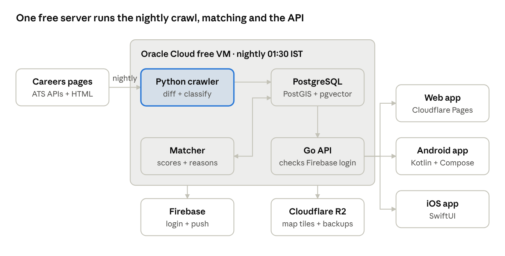

# CareerGlobe — Product & Build Spec

## Decisions locked in

CareerGlobe is a free, private, invite-only app that puts every company in India on a 3D globe and shows only the jobs from their own careers pages, re-checked every night. "CareerGlobe" is a working name; rename it anytime.

| Area           | Decision                                                                                                                                                                                                                                                                                        |
|----------------|-------------------------------------------------------------------------------------------------------------------------------------------------------------------------------------------------------------------------------------------------------------------------------------------------|
| Purpose        | Personal / portfolio project first, paid service later                                                                                                                                                                                                                                          |
| Coverage       | All of India at launch, then the world                                                                                                                                                                                                                                                          |
| Companies      | Startups plus product-based and service-based companies                                                                                                                                                                                                                                         |
| Job source     | Only each company's own careers page (or the ATS board it links to), listed in a seed file. No LinkedIn, Naukri, Indeed or aggregators                                                                                                                                                          |
| Refresh        | Every company re-checked automatically every night, results live by morning (IST)                                                                                                                                                                                                               |
| Users          | Job seekers only, and private: nobody gets past the login screen without an access code you issue. Signup happens only after a valid code                                                                                                                                                       |
| Price to users | Free                                                                                                                                                                                                                                                                                            |
| Applying       | Redirect to the company's own job page. No in-app apply                                                                                                                                                                                                                                         |
| Role filters   | Every kind of job, filterable by category: Software Engineering, Hardware & Semiconductor (VLSI, embedded, firmware, PCB), Design (UI/UX, product, visual), Product, Data & AI, QA & Testing, DevOps & IT, Recruiting/HR, Sales, Marketing, Operations, Finance, Customer Support, Legal, Other |
| Matching       | Upload resume with a consent checkbox → ranked jobs by fit + preferred locations. No in-app delete buttons for resume or account                                                                                                                                                                |
| Tracking       | Save and track applications: Saved → Applied → Interview → Offer (plus Rejected / Withdrawn)                                                                                                                                                                                                    |
| Running cost   | Zero rupees per month (see the next section for the few unavoidable one-time fees)                                                                                                                                                                                                              |
| Platforms      | Fully native: Swift + SwiftUI on iOS, Kotlin + Jetpack Compose on Android, plus a web app                                                                                                                                                                                                       |
| Builder        | You + Claude Opus 5.5 (Claude Code), with designs from a separate design AI                                                                                                                                                                                                                     |

## What changed in this revision

The original decisions all stand. This revision fills gaps that would have caused bugs, data loss or rework once building starts:

- **Crawler correctness.** Jobs only close after two nights in which that company was crawled successfully; a sudden drop to zero jobs is treated as a broken page, not as mass closure. URLs are normalised before hashing so tracking parameters cannot create duplicate jobs.

- **Run budget.** The nightly crawl now has a hard finish time, concurrency caps and a memory limit for the headless browser, so it fits on the 12 GB server and is done before the morning push.

- **Invite codes.** Codes are hashed with a secret pepper (short codes are otherwise easy to brute-force from a leaked hash), tickets are single-use, and redemption is race-safe.

- **Data model.** Added the tables the spec described but never defined: consents, push device tokens, removal requests, code attempts; plus missing job columns (salary, posted date, closed date) and the indexes the globe and matcher need.

- **Matching.** Clear seniority bands, skill synonyms, a rule for jobs that list no skills, and a small test set so weight changes can be measured instead of guessed.

- **New sections:** Security and operations (server hardening, secrets in a public repo, encrypted backups with restore drills, monitoring) and Legal and compliance (DPDP Act, job-description copyright, Terms and Privacy Policy).

- **Roadmap.** A Phase 0 for setup, and a measurable "done when" for every phase.

- **Open risks** are listed at the end so the trade-offs you chose stay visible.

## Zero-cost architecture

Run everything on one free Oracle Cloud ARM server, serve the web app from Cloudflare, and use Firebase only for login and push. Monthly bill: zero.

| Piece            | Free service                                  | What runs there                                                           | Watch out for                                                                                                                                                                                                                                   |
|------------------|-----------------------------------------------|---------------------------------------------------------------------------|-------------------------------------------------------------------------------------------------------------------------------------------------------------------------------------------------------------------------------------------------|
| Main server      | Oracle Cloud Always Free, Ampere A1 ARM VM    | Go API, PostgreSQL + PostGIS + pgvector, the nightly crawler, the matcher | Free ARM limit was cut to 2 OCPU / 12 GB RAM, enforced from 18 Aug 2026 ([source](https://terminalbytes.com/oracle-cloud-free-tier-changes-2026)). Card needed to verify signup. ARM capacity can be scarce; try the Mumbai or Hyderabad region |
| Nightly schedule | A systemd timer on the same VM, 01:30 IST     | Kicks off the crawl, then matching, then alerts                           | Nothing external to break                                                                                                                                                                                                                       |
| Backup schedule  | GitHub Actions (public repo)                  | Watchdog: checks last night's crawl finished, re-triggers if not          | Free on public repos, but scheduled workflows auto-disable after 60 days with no repo activity ([GitHub docs](https://docs.github.com/actions/learn-github-actions/usage-limits-billing-and-administration))                                    |
| Login            | Firebase Authentication                       | Email + Google + Apple sign-in, only after a valid access code            | Skip phone OTP: SMS costs money                                                                                                                                                                                                                 |
| Push alerts      | Firebase Cloud Messaging                      | "New matches this morning" on Android, iOS, web                           | Free                                                                                                                                                                                                                                            |
| Web hosting      | Cloudflare Pages                              | The web app                                                               | Allows commercial use later. Avoid Vercel Hobby: it is for non-commercial use only                                                                                                                                                              |
| Map tiles        | Protomaps (one PMTiles file) on Cloudflare R2 | The globe and street-level map                                            | No per-view fees, unlike Mapbox or Google Maps                                                                                                                                                                                                  |
| Backups          | Cloudflare R2                                 | Nightly pg_dump of the database                                           | Stay inside R2's free storage                                                                                                                                                                                                                   |



system architecture · all free tiers

The crawler fills Postgres at night, the matcher scores jobs for each user, and the API serves all three apps by morning.

Why not Supabase for the database: its free plan caps the database at 500 MB and pauses projects after one week of inactivity ([source](https://www.cloudzero.com/blog/supabase-pricing/)). Indian job descriptions will outgrow 500 MB quickly; Postgres on the Oracle VM has no such cap.

**The only money you cannot avoid:**

- Apple Developer Program: about \$99 per year to publish the iOS app. Until then, ship web + Android and test iOS on your own phone.

- Google Play: a one-time \$25 registration.

- Custom domain: optional, around ₹800–1,000 a year. A free \*.pages.dev address works until then.

Everything else (Claude, design AI, crawling, hosting) stays at zero.

## Nightly careers-page crawler

Every night the crawler visits only each company's careers page, reads the open roles, and marks roles that disappeared as closed. Nothing else on the company's site is touched.

### One seed file, one command

You keep a single file listing every company's careers page. One Python program reads it, crawls every row to the end, and saves the jobs. The nightly timer runs the same command.

**The seed file** (seeds/companies.csv, kept in a Git repo so every addition has history):

```csv
name,website,careers_url,city,state,type,ats
Zoho,https://www.zoho.com,https://careers.zohocorp.com,Chennai,Tamil Nadu,product,
Acme Semiconductors,https://acme.example,https://acme.example/careers,Bengaluru,Karnataka,product,
```

Leave ats blank; the program detects it and fills it in.

**The program:**

```bash
python crawl.py --seeds seeds/companies.csv # full run, start to finish
python crawl.py --only "Zoho" # one company, for testing
python crawl.py --resume # continue a run that stopped
python discover.py --websites seeds/new.txt # websites in, careers URLs + ATS out
```

What one run does:

1.  Loads the CSV and adds or updates each company in Postgres.

2.  Detects each careers page's ATS once (from the URL host or links on the page) and remembers it.

3.  Crawls with async HTTP: many hosts in parallel, but one request at a time per host.

4.  Saves a checkpoint after every company, so --resume skips the ones already done.

5.  Writes jobs, applies the two-night closing rule, and prints a summary: companies OK / failed, jobs new / closed.

6.  Writes failed.csv with the reason for each failure, so you know exactly what to fix.

- Respects a **run budget**: stops starting new companies at 05:30 IST so matching and the 08:00 push always run; unfinished companies carry over to the next night first.

**Libraries (all free):** httpx (async HTTP), selectolax (fast HTML parsing), extruct (JSON-LD job data), Playwright (JavaScript-only pages, last resort), psycopg (Postgres), tenacity (retries), and Python's built-in robots.txt parser.

**Why this is better than a plain list:**

- discover.py means you only need company websites. It finds the careers page and ATS and writes them back to the CSV for you to check.

- A Git-tracked seed file doubles as your company directory, and each push keeps the GitHub watchdog's scheduled workflow from auto-disabling.

- Python has the best scraping libraries and is quick for Claude to write. The Go API never talks to the crawler; they only share the database.

### How one company is read (cheapest and most reliable first)

1.  **Known ATS with a public job-board API.** Many careers pages are powered by an applicant-tracking system that serves clean JSON. One adapter per ATS unlocks every company on it:

    - Global: Greenhouse, Lever, Ashby, SmartRecruiters, Workable, Recruitee, Workday (myworkdayjobs), iCIMS, SuccessFactors, Oracle Taleo.

    - Common in India: Keka, Darwinbox, Zoho Recruit, Freshteam.

    - Verify each endpoint by hand once before coding its adapter; formats change.

2.  **schema.org JobPosting data in the page.** Many custom careers pages embed it so Google for Jobs can index them. Parse the JSON-LD; no guessing.

3.  **Plain HTML with saved selectors.** For a custom page, store CSS selectors for that company (title, location, link) in the database. Fix them from the admin screen when a page changes.

4.  **Headless browser, last resort.** Only for pages that render jobs with JavaScript and have no API. Use Playwright for Python. Cap these, because they are slow and heavy on 12 GB RAM.

### Run budget on a 2 OCPU / 12 GB server

- **Concurrency:** up to 32 hosts in flight over HTTP, but at most 2 headless browser pages at once, each killed after 45 seconds.

- **Memory:** run the crawler as its own systemd service with MemoryMax=6G so a runaway browser can never starve PostgreSQL or the API.

- **Time:** start 01:30 IST, stop launching new work at 05:30, matching 05:30–07:30, push at 08:00. Log the duration of every company so slow ones can be moved earlier or fixed.

- **Rough sizing:** at a 1.5 second gap per host, one host with 400 company boards (a large ATS) takes about 10 minutes, so the per-host rule is fine at India scale if ATS boards use the bulk API rather than one page per job.

### Cleaning what comes back

- **Canonical URLs:** lowercase the host, drop utm\_\*, ref, source and session parameters, drop the \#fragment and trailing slash, sort the remaining query parameters. Hash this, not the raw URL.

- **City names:** one alias table (Bangalore, Bengaluru, BLR → Bengaluru; Gurgaon, Gurugram → Gurugram; Noida, Delhi, Gurugram → Delhi NCR region). "Multiple locations" or "Pan India" becomes every listed city, or the state, never a single wrong pin.

- **Salary:** parse only when the posting states it (₹ x–y LPA, per month, per annum); otherwise leave empty. Never guess salaries.

- **Duplicates:** if the same job appears on the company page and its ATS board, keep the ATS copy (it has a stable ID) and drop the other.

- **HTML in descriptions:** strip scripts and styles, keep basic formatting, cap stored text at 20,000 characters.

### What happens to each job

- Job key = hash of company + the ATS job ID (or the job URL).

- New key → insert, set first_seen.

- Key seen again → update last_seen.

- Key missing on **two consecutive successful crawls of that company** → mark closed and set closed_at. A night where the company failed (timeout, block, error) does not count, so outages never close jobs.

<!-- -->

- **Sanity check:** if a company that had 5 or more open jobs suddenly returns 0, or loses more than 80% at once, treat it as a broken page: close nothing, flag it in the admin queue.

- A closed job that reappears with the same key is reopened, keeping its first_seen.

<!-- -->

- Then classify: role category, seniority, city, work mode (remote / hybrid / on-site).

- Then re-run matching and send the morning push: "12 new matches."

### Crawling rules (non-negotiable)

- Obey robots.txt. Skip and flag any page that disallows crawling.

- One request at a time per host, with a 1–2 second gap. Many companies share one ATS host, so the limit is per host, not per company.

- Identify yourself: a user agent with your site name and a contact page.

- Use ETag / If-Modified-Since, so unchanged pages cost almost nothing.

- Never log in, solve CAPTCHAs or get around blocks. After 3 failures, flag the company for review.

- Store only job fields and the link, never whole pages. Credit the source and add a "remove my company" contact.

### Finding India's companies for free

No free list holds every company, so build the directory in layers and keep only companies that have a careers page:

- Startup India (DPIIT-recognised startups list).

- MCA company master data on data.gov.in (registered companies with addresses; filter by industry code).

- Wikidata: companies in India with website and coordinates.

- Y Combinator and other public accelerator directories, filtered to India.

- Your own seed list of well-known product and service companies.

- Careers URL discovery: from each website, try /careers and /jobs, and look for links to the ATS hosts above.

- Coordinates: geocode each office address once with Nominatim (OpenStreetMap; at most 1 request per second, a real user agent, and attribution shown on the map), then cache it forever. If an address does not geocode, fall back to the city centre and mark it approximate.

- Product vs service tag: keyword rules first, then fix by hand in the admin screen.

## Tech stack

Decided: fully native apps, with no shared cross-platform code. Each platform uses its own language and UI toolkit, and all three talk to the same Go API.

| Layer       | Choice                   | Key libraries                                                                                                       |
|-------------|--------------------------|---------------------------------------------------------------------------------------------------------------------|
| iOS app     | Swift + SwiftUI          | URLSession + async/await, SwiftData for offline cache, Firebase Auth + Messaging SDKs, MapLibre Native iOS          |
| Android app | Kotlin + Jetpack Compose | Ktor or Retrofit, Room for offline cache, Hilt, Firebase Auth + Messaging SDKs, MapLibre Native Android, Material 3 |
| Web app     | TypeScript + SvelteKit   | MapLibre GL JS (globe projection), Firebase Auth JS SDK                                                             |
| API         | Go                       | net/http or chi, pgx, sqlc, Firebase Admin SDK for token checks                                                     |
| Crawler     | Python                   | httpx, selectolax, extruct, Playwright, psycopg                                                                     |
| Database    | PostgreSQL               | PostGIS, pgvector (later)                                                                                           |

How to keep three native apps manageable:

- **One API contract.** Write an OpenAPI file for the Go API and generate the Swift and Kotlin network clients from it, so models never drift apart.

- **Same screen IDs everywhere.** S01–S30 mean the same thing in SwiftUI, Compose and web, so one design maps to three builds.

- **Platform look, shared brand.** iOS follows Apple's Human Interface Guidelines and Android follows Material 3, both using the same colour and type tokens.

- **Globe on phones.** Check how far globe mode has reached in MapLibre's native SDKs when you start. If it is not there yet, open the phone apps on a flat world map and keep the full 3D globe on web.

- **Build order:** API + crawler → web → Android → iOS. Each new app reuses the API and designs, so it goes faster than the last.

<!-- -->

- **Phones before the native apps:** make the SvelteKit web app installable (a PWA with a manifest and service worker). Friends can use it on Android and iPhone from day one while the native apps are built.

- **Versioned API:** prefix routes with /v1 and never break a released app; add fields, do not rename them.

## Resume matching at zero cost

Matching runs on your own server with rules plus a small open-source model, with no paid AI API at runtime. Claude is for building the app, not for running it.

### Parsing the resume

1.  Accept PDF and DOCX up to 5 MB. Extract text in Go (a PDF text library; DOCX is zipped XML). For scanned PDFs, ask the user to upload a text PDF rather than running heavy OCR.

2.  Pull out: skills (matched against the free ESCO skills list plus your own skill lists for software, hardware/VLSI (Verilog, SystemVerilog, UVM, Cadence, Synopsys, embedded C) and design (Figma, user research, prototyping)), job titles, total years of experience from date ranges, current city, education.

3.  **Always show the parsed result for the user to confirm and edit.** Parsers make mistakes; a user-corrected profile matches far better.

- **Skill synonyms:** one editable table (JS → JavaScript, k8s → Kubernetes, SV → SystemVerilog, ReactJS → React) applied to both resumes and jobs before comparing.

- **Seniority bands:** Intern 0 years, Fresher 0–1, Junior 1–3, Mid 3–6, Senior 6–10, Lead+ 10 or more. Titles with no level read as Mid.

### Scoring a job (0–100, always explained)

Hard filters first: job is open, matches the user's role categories, and is in a preferred city or is remote (if they allow remote). Then score:

| Signal                 | Weight | How                                                                                  |
|------------------------|--------|--------------------------------------------------------------------------------------|
| Skills overlap         | 45%    | Skills in the job text that the profile has, over skills the job asks for            |
| Role fit               | 20%    | Job title vs the user's titles and chosen categories                                 |
| Seniority fit          | 15%    | Years of experience vs the level read from the title (Intern, Junior, Senior, Lead…) |
| Location and work mode | 15%    | Exact city \> same state \> remote                                                   |
| Freshness              | 5%     | Newer first_seen scores higher                                                       |

Every score shows its reason, for example "Matches 7 of 9 skills · missing Kubernetes, GraphQL". Treat the weights as a starting point and tune them by testing on your own resume.

**Edge cases.** If a job lists fewer than 3 recognised skills, skills overlap is skipped and its 45% is shared by role fit and seniority; the reason says "Few skills listed in this posting". If the user set a minimum salary, it filters only jobs that state a salary. Only jobs scoring 60 or more count as a "match" for pins, counts and the morning push.

**Measure before tuning.** Keep a test set of 3–5 resumes (yours and friends', with consent) and mark 50 jobs each as good or bad fit. After any weight change, check how many of the top 20 are good fits. Change weights only when that number goes up.

**Morning push.** At most one per day, at the user's chosen time (default 08:00 IST), only when there is at least one new match scoring 60 or more. Nothing to report, no push.

**Later (still free):** run a small open embedding model (for example bge-small via ONNX) on the server's CPU, store vectors in pgvector, and blend similarity into the score. Embed only new jobs each night to keep it light.

### Role categories

Assign each job one category from its title with a keyword table you can edit in admin. Unknown titles go to Other and appear in an admin review queue.

| Category                 | Example title keywords                                                                                                                 |
|--------------------------|----------------------------------------------------------------------------------------------------------------------------------------|
| Software Engineering     | Software, SDE, Backend, Frontend, Full Stack, Android, iOS, Mobile                                                                     |
| Hardware & Semiconductor | VLSI, RTL, ASIC, FPGA, Design Verification, Physical Design, DFT, Analog, Mixed Signal, Embedded, Firmware, PCB, Hardware, Electronics |
| Design                   | UI, UX, UI/UX, Product Designer, Visual Designer, Interaction, Graphic, UX Researcher                                                  |
| Product                  | Product Manager, Product Owner, Program Manager                                                                                        |
| Data & AI                | Data Scientist, Data Analyst, Data Engineer, ML, AI Engineer                                                                           |
| QA & Testing             | QA, Test, SDET, Automation Tester                                                                                                      |
| DevOps & IT              | DevOps, SRE, Cloud, Platform, System Administrator, Network, Security                                                                  |
| Recruiting/HR            | Recruiter, Talent Acquisition, HR, People                                                                                              |
| Sales                    | Sales, Account Executive, Business Development, Pre-sales                                                                              |
| Marketing                | Marketing, Growth, SEO, Content, Brand                                                                                                 |
| Operations               | Operations, Supply Chain, Admin, Project Coordinator                                                                                   |
| Finance                  | Finance, Accountant, FP&A, Audit                                                                                                       |
| Customer Support         | Support, Customer Success, Service Desk                                                                                                |
| Legal                    | Legal, Counsel, Compliance                                                                                                             |

Some titles fit two categories ("Embedded Software Engineer"); store a primary and a secondary category so the job shows under both filters.

### Privacy

- At upload, a required checkbox with this text: **"I agree to share my resume and profile details with CareerGlobe so it can find more relevant, better-matched jobs for me. I have read the Privacy Policy."** Upload stays disabled until it is ticked. Store the date, time and policy version of each consent.

- No "Delete resume" or "Delete account" buttons in the app. Users can replace their resume.

- Encrypt resume files at rest with AES-256-GCM; the key lives in the server's environment file, never in the database or the repo. Store files outside the web root under random names. Never sell or share them.

- Keep one exit outside the app: the Privacy Policy gives a contact email for data removal requests, and you handle them from the admin console. India's DPDP Act gives people the right to withdraw consent and have their data erased, so this email is the minimum.

- If you ever publish to the App Store, Apple requires apps that let users create accounts to offer account deletion inside the app. Google Play also requires a deletion option. Add the buttons back at that point.

<!-- -->

- **Recommendation:** add a "Delete my account and data" option in Settings now rather than at publishing time. It is one screen and one endpoint, it makes DPDP erasure requests self-serve, and it removes a store-review blocker later. The no-delete decision stays yours; this is the cheaper moment to change it.

- Retention: delete resumes and profiles 12 months after the last login, after one email warning. Keep crawl logs 90 days.

## Private access with invite codes

The app stays private by making every user enter an access code you issued before they can sign up, and the server re-checks it on every request.

1.  You create codes in the admin console (or a small CLI): random codes like CG-7K4P-2QXM from an alphabet without look-alike characters (no 0/O, 1/I/L), each with a label (who it is for), max uses (default 1), an optional expiry date and a revoked flag. Only an HMAC-SHA256 of the code with a secret server pepper is stored; a plain hash of a short code can be brute-forced if the database leaks.

2.  Login screen asks for the code first. The app sends it to POST /v1/access/verify; a valid code returns a signed, single-use ticket that expires in 10 minutes. Verifying does not use up the code.

3.  Then sign up with Google, Apple or email through Firebase. The app calls POST /v1/access/redeem with the Firebase token and the ticket; in one database transaction the server locks the code row, re-checks it is still valid and under max_uses, links the account and increments used_count. Two people racing for the last use cannot both get in.

4.  **Every API request checks two things:** a valid Firebase token and an account linked to a code that is not revoked. Revoke a code and its users are locked out at once.

5.  Stop guessing: at most 5 code attempts per device/IP every 15 minutes, counted in an access_attempts table, plus a global alarm in the admin console if failures spike.

6.  **Returning users** log in normally; they never re-enter the code.

- Someone who signs in with Firebase but never redeemed a code gets 403 "access code required" from every endpoint, and the app sends them to S04.

- Cache the "is this user allowed" check for 60 seconds in memory so it does not cost a query per request; revocation still takes effect within a minute.

The check must live in the Go API, not just the screens. Anyone can create a bare Firebase account, so the API, not the login screen, is what keeps the app private.

## Data model

Eighteen PostgreSQL tables cover the whole first version (the original thirteen plus five that the rest of the spec needs); PostGIS holds office locations and pgvector is added later for embeddings.

| Table              | Key columns                                                                                                                                                                                                                                            | Purpose                                          |
|--------------------|--------------------------------------------------------------------------------------------------------------------------------------------------------------------------------------------------------------------------------------------------------|--------------------------------------------------|
| companies          | id, name, slug, website, logo_url, type (product / service / both), stage, size_band, industry, description, verified_at                                                                                                                               | One row per company                              |
| company_locations  | company_id, city, state, country, geo (PostGIS point), is_hq                                                                                                                                                                                           | Pins on the globe                                |
| careers_sources    | company_id, careers_url, ats_type, ats_slug, selectors (JSON), etag, last_modified, last_attempt_at, last_ok_at, last_error, fail_count, status                                                                                                        | How to read each careers page                    |
| jobs               | id, company_id, job_key (hash, unique), source_job_id, title, category, category_2, seniority, description, cities\[\], work_mode, salary_min, salary_max, apply_url, posted_at, first_seen, last_seen, missed_runs, closed_at, status (open / closed) | Every job ever seen                              |
| crawl_runs         | id, started_at, finished_at, companies_ok, companies_failed, jobs_new, jobs_closed                                                                                                                                                                     | One row per night; feeds the admin dashboard     |
| users              | id, firebase_uid (unique), access_code_id, name, email, created_at, last_login_at                                                                                                                                                                      | Account                                          |
| profiles           | user_id, skills\[\], titles\[\], years_exp, current_city                                                                                                                                                                                               | Confirmed resume data                            |
| resumes            | user_id, file_path (encrypted), parsed_at                                                                                                                                                                                                              | The uploaded file                                |
| preferences        | user_id, categories\[\], cities\[\], remote_ok, seniority, min_salary, push_time                                                                                                                                                                       | What the user wants                              |
| matches            | user_id + job_id (primary key), score, reasons (JSON), computed_at, notified_at, seen                                                                                                                                                                  | Rebuilt nightly                                  |
| applications       | id, user_id, job_id, status (saved / applied / interview / offer / rejected / withdrawn), applied_at, notes, next_step_at                                                                                                                              | The tracker                                      |
| application_events | application_id, from_status, to_status, at, note                                                                                                                                                                                                       | Timeline of each application                     |
| access_codes       | id, code_hash, label, max_uses, used_count, expires_at, revoked, created_at                                                                                                                                                                            | Invite codes that gate signup and every API call |
| consents           | user_id, policy_version, accepted_at, ip, user_agent                                                                                                                                                                                                   | Proof of each consent (DPDP)                     |
| push_tokens        | user_id, platform, fcm_token (unique), updated_at                                                                                                                                                                                                      | Where to send push alerts; one per device        |
| access_attempts    | ip, device_id, at, success                                                                                                                                                                                                                             | Rate limiting for code guesses                   |
| removal_requests   | id, email, user_id, received_at, done_at, note                                                                                                                                                                                                         | Data-removal and "remove my company" requests    |
| saved_companies    | user_id, company_id, created_at                                                                                                                                                                                                                        | Saved companies and their alerts                 |

Also keep a small category_rules table (keyword → category), plus skill_synonyms and city_aliases tables, so admin can edit classification without a deploy.

**Indexes that matter:** GIST on company_locations.geo (globe pan queries), unique on jobs.job_key, (company_id, status) and (status, first_seen) on jobs, GIN on profiles.skills, (user_id, score DESC) on matches. Manage the schema with numbered migration files (for example goose or golang-migrate) from day one.

**Globe queries:** the companies-in-view endpoint takes the map bounds and zoom, returns at most 500 pins, and clusters server-side with PostGIS when zoomed out, so a view of all India never ships thousands of rows to a phone.

## Security and operations

One server holds everything, so it needs to be locked down and recoverable. All of this is free.

### Server

- **No open ports except SSH.** Put the API behind a Cloudflare Tunnel (free), so the VM's IP is never public and Cloudflare absorbs abuse. SSH with keys only, password login off.

- **PostgreSQL listens on localhost only.** Separate database users for the crawler (write jobs), the API (read jobs, write user data) and backups (read only).

- **Automatic security updates** (unattended-upgrades), a firewall, and log rotation so logs never fill the disk.

- **Idle reclamation:** Oracle can reclaim Always Free VMs it considers idle (very low CPU, network and memory use over 7 days). The nightly crawl usually prevents this, but check the current Always Free policy and keep an eye on the account emails.

### Secrets in a public repo

- The repo is public so the GitHub watchdog stays free. Nothing secret ever goes in it: keys, the code pepper, the encryption key and Firebase service accounts live in a server .env file (chmod 600) and in GitHub Actions secrets. Add .env to .gitignore and turn on GitHub secret scanning.

- Keep the admin console behind its own check (your Firebase account ID allow-listed on the server), not just a hidden URL.

### Backups that actually restore

- Nightly pg_dump, encrypted with age before upload to R2, keeping 7 daily and 4 weekly copies. Resume files are backed up the same way.

- Once a month, restore the latest backup into a scratch database and run a row count. A backup you have never restored is a guess.

- Write the rebuild steps (create VM, install, restore, point the tunnel) in the repo so a lost VM is an evening's work, not a rewrite.

### Knowing when something breaks

- The crawl, matcher and backup each ping a free heartbeat monitor (for example healthchecks.io) when they finish; a missed ping emails you.

- The admin console shows last night's crawl_runs row and turns red if it is missing or if failures exceed 10%.

- An uptime check on the API's /healthz endpoint.

## Legal and compliance

- **DPDP Act:** a clear notice at consent, a named grievance contact, erasure on request, and a plan for reporting a data breach to users and the Data Protection Board. Check the current DPDP Rules before launch because their timelines are what you must meet.

- **Job descriptions are the company's content.** Store the full text for matching, but show a short excerpt plus key facts in the app and send people to the careers page for the full posting. Credit the company on every job.

- **Terms and Privacy Policy** exist before the first friend signs up: what is collected, why, how long it is kept, the removal email, and that jobs are shown as found with no guarantee.

- **Company opt-out:** a "remove my company" request is honoured within 7 days and the company is marked do-not-crawl in the seed file.

- When the paid version arrives, revisit everything here: payments, GST and stricter terms.

## UI spec: every screen

The app has 30 screens in 7 groups. Each needs three designs: native iOS (Apple's Human Interface Guidelines), native Android (Material 3) and desktop web. The phone versions share a layout but use each platform's own controls; on web, the globe stays on the left and lists open in a right-hand panel.

Main navigation (bottom tabs on mobile, left rail on web): **Globe · Matches · Tracker · Saved · Profile**.

### A. Before signup (public)

1.  **S01 Landing page (web only).** Hero with a slowly spinning, slightly blurred globe dotted with company pins; headline; live counters (companies, open jobs, "updated this morning"); 3 feature blocks (globe, resume match, tracker); "I have an access code" button with a short "Private, invite-only" note (no public signup); footer with About, Privacy, Terms, Contact.

2.  **S02 Splash (mobile).** Logo on the globe; under one second.

3.  **S03 Welcome carousel (mobile).** 3 slides: Explore companies on the globe · Jobs matched to your resume · Track every application. Skip and Get started.

4.  **S04 Access code + Sign up.** Step 1: one access-code field and Continue; nothing else on the screen works without it. Wrong, used-up, expired or revoked codes show a clear error; after 5 failed tries show a 15-minute lockout message. Step 2 (only after a valid code): Continue with Google, Continue with Apple, email + password; terms checkbox. Small "Already have an account? Log in" link.

5.  **S05 Log in.** Same providers; Forgot password link. No code needed again. If the user's code was revoked, show "Your access has been removed" and nothing else.

6.  **S06 Verify email.** "Check your inbox" with resend timer.

7.  **S07 Forgot / reset password.**

### B. Onboarding (first run, one step per screen, progress bar on top)

8.  **S08 Upload resume.** Drag-and-drop (web) or file picker (mobile); PDF/DOCX, 5 MB; required consent checkbox with the exact text from the Privacy part of Resume matching, and the Upload button disabled until it is ticked; "Skip for now" (matching stays off until uploaded). States: uploading, parsing ("Reading your resume…"), failed ("Couldn't read this file — try a text PDF").

9.  **S09 Review parsed profile.** Editable chips for skills (add/remove), job titles, years of experience (stepper), current city. "Looks good" button.

10. **S10 Role categories.** Multi-select tiles with an icon each: Software Engineering, Hardware & Semiconductor (VLSI, embedded), Design (UI/UX), Product, Data & AI, QA & Testing, DevOps & IT, Recruiting/HR, Sales, Marketing, Operations, Finance, Customer Support, Legal, Other.

11. **S11 Preferred locations.** City search with chips (Bengaluru, Pune, Hyderabad, Mumbai, Delhi NCR, Chennai…); "Open to remote" toggle; "Anywhere in India" option.

12. **S12 Experience level and pay.** Seniority chips (Intern, Fresher, Junior, Mid, Senior, Lead+); optional minimum salary in ₹ LPA.

13. **S13 Notifications.** Explain the 8 AM "new matches" push; Allow / Not now.

### C. Globe (home tab)

14. **S14 Globe home.** Full-screen 3D Earth, opens centred on India. Pins cluster with counts and split as you zoom; smooth zoom to street level. Top: search bar and filter button. Under it: horizontal filter chips (Matches only, Remote, category, Product/Service, Hiring now). Bottom sheet (mobile) / right panel (web): "Companies in view" list that updates as you pan, sorted by matches. "Updated today 6:00 AM" label. Pin colours: has matching jobs vs hiring vs not hiring.

15. **S15 Company preview sheet.** Tapping a pin: logo, name, Product/Service tag, city, open jobs count, your match count, Save and View company buttons. Cluster tap with many companies at one address shows a short list instead.

16. **S16 Filters sheet.** Role category, city/state, work mode, company type, stage (Bootstrapped, Seed, Series A+, Public), size band, posted within (24h, 7d, 30d), matches only. Reset and Apply buttons with live result count.

17. **S17 Search.** One box for companies, jobs and cities; recent searches; grouped results.

### D. Companies and jobs

18. **S18 Company detail.** Header with logo, name, tags, website and careers page links, Save. About text. Small map of office locations. Open roles list grouped by category, with match badges. "Careers page last checked: today 2:14 AM." Report wrong info link.

19. **S19 Matches (tab).** Ranked job cards: title, company logo/name, city/remote, category, match score ring, top reason line, "New" badge, posted/first-seen age, save icon. Sort (best match / newest) and the same filter chips. Pull to refresh.

20. **S20 Job detail.** Title, company, location, work mode, first seen, last verified. **Match breakdown card:** score, skills you have (green chips), skills missing (grey chips), seniority and location fit. Job description (from the careers page). Sticky bottom: Save, and **Apply on company site** (opens the external page).

21. **S21 "Did you apply?" prompt.** Shown when the user returns from the external site: Yes, applied (moves to Applied in the tracker, with date) · Not yet · Don't ask for this job.

22. **S22 Job closed state.** The job detail with a "No longer on the careers page since 18 Oct" banner; similar open jobs below.

### E. Application tracker (tab)

23. **S23 Tracker board.** Columns Saved → Applied → Interview → Offer, plus a collapsed Rejected / Withdrawn group. Web: drag-and-drop kanban. Mobile: segmented tabs with counts and swipe actions to move a card. Card: company logo, title, date of last change, next-step date if set, "closed" warning if the job left the careers page.

24. **S24 Application detail.** Status dropdown, timeline of status changes, interview rounds (add round: date, type, notes), free-text notes, next step with date and reminder, link back to the job.

25. **S25 Tracker stats (small header or panel).** Counts per stage and response rate (applied → interview).

### F. Saved, alerts and profile

26. **S26 Saved.** Two tabs: Saved jobs, Saved companies (get notified when they post a matching role).

27. **S27 Notifications inbox.** "14 new matches this morning", "Company you saved posted 2 jobs", "Interview tomorrow" reminders.

28. **S28 Profile.** Resume file with Replace; editable skills and titles; preferences (links back to S10–S12); account info.

29. **S29 Settings.** Notification toggles and morning time, theme (system/light/dark), Privacy: what is stored and why, and the consent you gave (with its date); About and data sources, Terms, Privacy Policy (with the data-request email), Log out.

### G. Admin (web only, only you)

30. **S30 Admin console.** Tabs: last night's crawl (companies OK / failed, new / closed jobs), failing companies queue with error and "fix selectors" form, add company (name, website, careers URL, location), category rules editor, unclassified titles queue, access codes (create with label, max uses and expiry; see who used each; revoke), data removal requests.

### States every screen needs

- Loading skeletons (cards, globe loading tiles).

- Empty states: no matches yet (prompt to widen filters or upload resume), empty tracker, nothing saved.

- Errors and offline banner, with retry.

- First-time hints on the globe (pinch to zoom, tap a pin).

- Dark and light themes for every screen.

## Design system and components

Ask the design AI for the design system first, then the screens; Claude Code turns the tokens into Compose, SwiftUI and CSS themes once and reuses them everywhere.

### Tokens to define

- Colours: background, surface, raised surface, text primary/secondary, one brand accent, and status colours for Saved, Applied, Interview, Offer, Rejected. Light and dark versions of each.

- Globe palette: ocean, land, borders, pin colours (matching jobs / hiring / not hiring), cluster bubble.

- Type scale: display, title, heading, body, caption, numeric (for counts and scores).

- Spacing on a 4 px grid; corner radii; elevation for sheets and cards.

- Motion: globe spin speed, zoom easing, sheet snap points, card move animation in the tracker.

- Icons: one consistent free set (for example Lucide or Material Symbols).

### Components to design

| Component                      | Variants and states                                                 |
|--------------------------------|---------------------------------------------------------------------|
| Map pin                        | Matching jobs, hiring, not hiring, selected                         |
| Cluster bubble                 | Small / medium / large count                                        |
| Company card                   | List row, compact sheet, saved                                      |
| Job card                       | Default, new, saved, closed                                         |
| Match score ring               | 0–100 with colour bands                                             |
| Skill chip                     | Have, missing, editable (with ×)                                    |
| Filter chip                    | Off, on, with count                                                 |
| Status pill                    | Saved, Applied, Interview, Offer, Rejected, Withdrawn               |
| Tracker card                   | Default, dragging, has next step, job closed warning                |
| Bottom sheet                   | Peek, half, full                                                    |
| Buttons                        | Primary, secondary, text, external-link ("Apply on company site ↗") |
| Inputs                         | Text, search, city picker, stepper, salary field, file drop zone    |
| Banners                        | Info, warning (job closed), error, offline                          |
| Empty state                    | Illustration slot + message + action                                |
| Skeletons                      | Card, list, detail                                                  |
| Bottom tab bar / web side rail | 5 items with active state                                           |

## Build roadmap

Build in eight phases (Phase 0 is setup), each one a small number of focused Claude Code sessions that ends with something working. Finish and test a phase before starting the next.

**Phase 0, setup.** Create the Oracle VM, Postgres with PostGIS, the Cloudflare Tunnel, the public repo with .gitignore and secret scanning, Firebase project, and an empty Go API that answers /healthz. Done when: /healthz responds through the tunnel and a backup restores.

1.  **Crawler core.** Python crawler, seed CSV, Postgres schema with migrations, adapters for Greenhouse, Lever and Keka with saved sample responses as tests, URL normalisation and the job diff logic; crawl.py runs 20 seed companies end to end. Done when: two runs in a row close nothing by mistake, a simulated outage for one company closes nothing, and a removed test job closes after two good runs.

2.  **More sources + nightly run.** Remaining ATS adapters, JSON-LD parser, selector-based HTML reader, discover.py, run budget and memory cap, systemd timer, crawl_runs logging, heartbeat monitor, GitHub Actions watchdog. Done when: 500 Indian companies refresh unattended for 7 nights, each finishing before 05:30 IST with under 10% failures.

3.  **API + auth.** Firebase token check plus the access-code check on every request, verify/redeem endpoints with rate limiting, an OpenAPI file, and /v1 endpoints for companies-in-view (by map bounds), company, job, matches, tracker, profile. Done when: every endpoint has a test, a revoked code is locked out within a minute, and a fresh Firebase account without a code gets 403 everywhere.

4.  **Resume + matching.** Upload with consent record, parse, confirm, nightly scoring with reasons, morning push. Done when: on the test set, at least 14 of each resume's top 20 matches are marked good fits, and scoring all users finishes inside its time window.

5.  **Web app.** Design tokens, then screens in this order: S04–S13, S14–S17, S18–S22, S23–S25, S26–S29, S01, S30. Installable as a PWA. Deploy to Cloudflare Pages. Done when: 5 friends sign up with codes and use it for a week, and the globe stays smooth with all pins on a mid-range Android phone.

6.  **Android app.** Kotlin + Jetpack Compose screens in the same order, with the network client generated from the OpenAPI file. Publish on Play (\$25).

7.  **iOS app.** Swift + SwiftUI screens in the same order, with the network client generated from the OpenAPI file. Publish when you pay for the Apple program.

After that: grow the company directory towards all of India, then add other countries one at a time.

### Open risks to keep an eye on

- **Three native apps for one person** is the biggest time cost in the plan. The PWA keeps phones covered meanwhile; revisit whether both native apps are worth it once the web app has real users.

- **One free server is a single point of failure.** Backups and written rebuild steps make it recoverable, not highly available. That is fine for a private beta.

- **Careers pages change and block crawlers.** Expect a few percent of companies to break every week; the admin failing-companies queue is part of the product, not an extra.

- **No in-app delete** conflicts with store rules and makes DPDP requests manual. See the recommendation under Privacy.

- **Free-tier terms change** (the Oracle ARM limit already did). Re-check Oracle, Firebase, Cloudflare and GitHub limits every few months.

### Saving Claude quota

- Keep a local, uncommitted notes file with the stack, folder layout, conventions and a link to this spec, so each session starts with context instead of re-discovering it.

- One feature or screen per session; start fresh sessions rather than one endless one.

- Give Claude Code the exported design for exactly the screen being built, plus the design tokens file.

- Ask for a short plan first on bigger tasks, approve it, then let it build.

- Write tests early (pytest tests for each ATS adapter with saved sample responses) so fixes don't need long back-and-forth.

- Use a lighter model (Sonnet or Haiku) for routine work such as renames, small fixes and boilerplate; save Opus for design and hard bugs.

## Design tools

Best free route: generate drafts in Google Stitch, finish and own them in Figma, then hand Claude Code one exported image per screen per platform. Claude's own Design canvas is a strong alternative that skips the hand-off.

| Tool                                                                      | Use it for                                                                                                                             | Output for native apps                                                                         | Cost                                           |
|---------------------------------------------------------------------------|----------------------------------------------------------------------------------------------------------------------------------------|------------------------------------------------------------------------------------------------|------------------------------------------------|
| [Google Stitch](https://moda.app/blog/google-stitch-review) (Google Labs) | Fast first drafts of mobile and web screens from a prompt, sketch or screenshot, several variations each                               | Exports to Figma and to code including HTML/Tailwind, Flutter and SwiftUI (no Jetpack Compose) | Free, with generation limits                   |
| Figma (free plan)                                                         | The final, editable source of truth: components, tokens, and Apple's iOS and Google's Material 3 UI kits so each platform looks native | PNG/SVG exports and design specs Claude Code builds from                                       | Free for personal files                        |
| Claude Design + Design System (in this Claude app)                        | Screens and a browsable design system next to this spec; Claude Code can read the same tokens                                          | Images and HTML; Claude Code rebuilds them in SwiftUI and Compose                              | Included in your Claude plan (uses your quota) |

Workflow:

1.  Make the design system first (tokens + components), in Figma or as a Claude Design System.

2.  Generate each screen group in Stitch, pick the best variation, and paste it into Figma ([Stitch's Figma export](https://divriots.com/blog/divriots-powers-google-stitch-export-feature)).

3.  In Figma, rebuild with the iOS kit and the Material 3 kit so each phone app feels native, and keep the web layout separate.

4.  Export every screen as S14_globe_ios.png, S14_globe_android.png, S14_globe_web.png, plus a tokens.json. Give Claude Code only the files for the screen it is building.

## Prompt for the design AI

Paste this, then paste the "UI spec: every screen" and "Design system and components" sections under it. Ask for the design system first, then screens one group at a time.

```text
You are designing CareerGlobe, a free, private, invite-only job-discovery app for job seekers in India.
Core idea: every company in India sits on an interactive 3D globe; tapping a company
shows its open jobs, read nightly from its own careers page. Users upload a resume
and get jobs ranked by match score with a plain reason ("Matches 7 of 9 skills").
They apply on the company's own site and track applications on a board:
Saved → Applied → Interview → Offer.
Access is invite-only: the first screen asks for an access code.
Jobs cover every field, including VLSI/hardware and UI/UX design.

Platforms: native iOS (Apple HIG, 393 px wide), native Android (Material 3, 412 px wide) and desktop web
(1440 px wide; globe on the left, lists and details in a right-hand panel).
Navigation: Globe · Matches · Tracker · Saved · Profile.

Style: calm, modern and trustworthy. The globe is the hero: a dark, space-like
backdrop with a clean Earth and glowing pins. Lists and forms stay simple and
readable. Every screen needs light and dark themes.

Deliver in this order:
1. Design system: colour tokens (light + dark), type scale, spacing, radii, icons,
and every component listed below with its states.
2. Screens group by group (A to G): iOS, then Android, then web, including loading,
empty and error states.
Name every screen with its ID (S01, S02…) so developers can match them.
Export tokens as JSON and screens as images or code I can hand to a developer.

[paste the screens and components sections here]

```